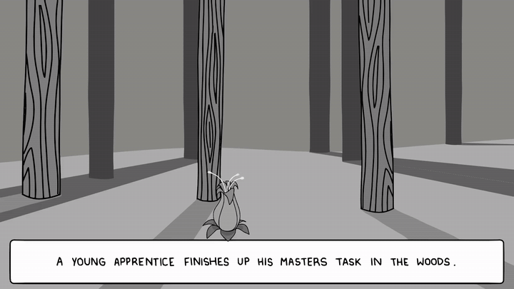
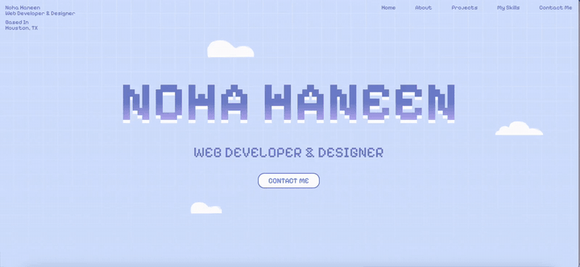
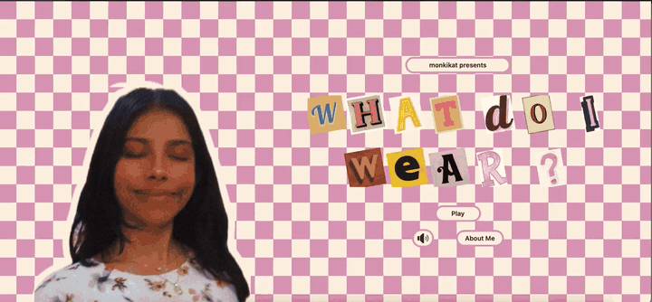
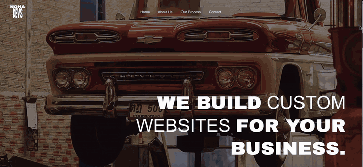
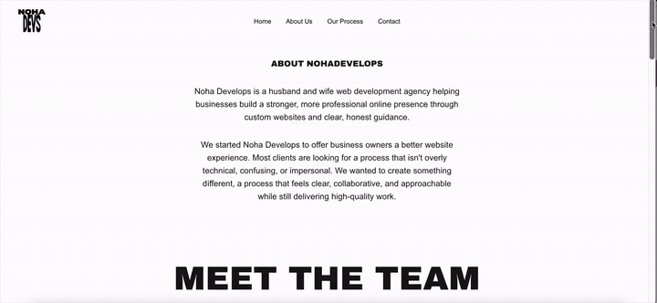
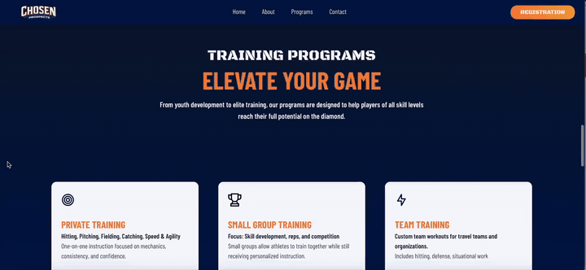

**Design Portfolio** · Game Art & Animation · Web & UI Design · Data Visualization

I like working on projects where design takes different forms, from animating game characters and building playful interfaces to creating websites and visualizing data. Here's a collection of some of the things I've made.

---

## 🎮 Game Art & Animation

### Pixel Art & Character Animation

A few animated assets I created for a game project, including character movement, an attack, and an enemy defeat animation.

| Roll | Attack | Enemy Defeat |
| :---: | :---: | :---: |
|  |  |  |

`Pixel Art` `Sprite Animation` `Game Assets`

### Animated Game Intro

A black-and-white animated opening sequence I worked on using Blender and Photoshop. I enjoyed putting together the characters, environments, and story moments to give the intro its own atmosphere.

[▶ Watch the full animated intro](assets/videos/animated-intro.mp4)

`Blender` `Adobe Photoshop` `2D/3D Animation` `Visual Storytelling`

---

## 🎨 Web & UI Design

### Pixel-Inspired Personal Website

A personal site with a soft blue palette, pixel-inspired lettering, floating clouds, and a playful landing page. I wanted it to feel a little more personal than a typical developer portfolio.

[▶ View the website walkthrough](assets/videos/personal-site.mp4)

`Web Design` `Visual Identity` `Motion`

### Interactive Dress-Up Interface

An interactive character-styling screen with clothing categories, item previews, and a simple layout that keeps the character front and center.

[▶ View the interface walkthrough](assets/videos/dress-up-ui.mp4)

`UI Design` `Interactive Design` `Game Interface`

### Noha Develops — Studio Website

A website with bold type, image-led sections, and an interactive visual approach to presenting a small web studio and its process.

**Homepage**

**Team & process**

[▶ View the homepage walkthrough](assets/videos/studio-home.mp4) · [View the team & process walkthrough](assets/videos/studio-site.mp4)

`Website Design` `Typography` `Layout` `Interaction`

### Chosen Prospects — Sports Training Website

A sports training website that organizes program options into clear, easy-to-scan cards, with contrasting colors and visible registration actions.

[▶ View the website walkthrough](assets/videos/chosen-prospects.mp4)

`Web Design` `Information Hierarchy` `UI Design`

---

## 📊 Data Visualization & Information Design

I also enjoy the design side of working with data: choosing how to organize information, highlight patterns, and make reports easier to explore.

### New Jersey Title I School Enrollment Dashboard

An interactive dashboard exploring grades 5–8 enrollment across Title I districts, with county and school rankings, filters, and summary metrics.

[View the Looker Studio dashboard](https://datastudio.google.com/s/su3t6rVxwMs#cd-lmd3vjac4d) · [Explore the project on GitHub](https://github.com/monkikat/Title-1-Schools-New-Jersey-Data-Analysis)

`Looker Studio` `Data Visualization` `Dashboard Design`

<!-- Optional: add your actual dashboard screenshot here when available.

-->

### Construction Employment Trends

A Power BI visualization project looking at construction employment trends over time, including patterns in the Houston area.

`Power BI` `Data Visualization` `Time-Series Reporting`

<!-- Optional: add your actual Power BI screenshot here when available.

-->

---

## 🛠️ Tools I Work With

**Design & animation:** Blender · Adobe Photoshop · Canva · Figma

**Web & interface design:** HTML · CSS · React · Next.js

**Data & reporting:** Power BI · Looker Studio · Microsoft Excel

---

## Find Me Online

[GitHub](https://github.com/monkikat) · [LinkedIn](https://www.linkedin.com/in/noha-haneen)

*Thanks for stopping by ☁️*
